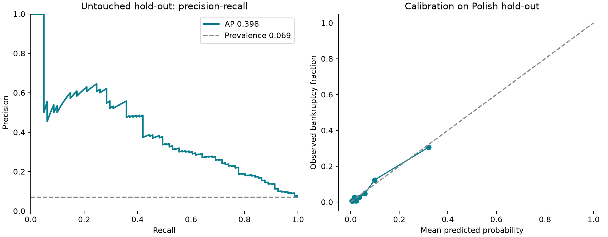

# Execution results: corporate early-warning research build

29 October 2026. **The benchmark and core pipeline are implemented. The full Indian competition submission is not complete.**
Indian four-quarter/eight-quarter recall and expected loss are deliberately withheld until the historical panel and publication timing are verified.

## What is working

| Deliverable | Actual status |
|---|---|
| Public benchmark model | Trained, calibrated and evaluated with a frozen grouped hold-out |
| Reproducible pipeline | Source collection, extraction candidates, reviewed fact ledger, ratios, M/F/Z functions, ranking and guarded replay |
| Source corpus | 196 downloaded PDFs, including 179 annual reports; hashes and original URLs retained |
| Indian case events | Ten documented CIRP dates; five earlier payment-default records separately identified |
| Case/control roster | Ten case candidates and thirty provisional distinct controls, after removing known unsuitable controls |
| Financial extraction | 4,309 source-linked numerical candidates; these are not automatically verified |
| Source-reviewed pilot | Four toll-road/EPC issuers; FY2016 plus comparative FY2015 values, with field-level source pages |
| Steel case dossier | Bhushan and three peers: nine numerical examples, explicit accounting proxies, conflicting default evidence and guarded cutoff checks |
| FY2011 original-source review | Four original consolidated statement reviews, 99 numerical/derived fields, gross balance checks and 42 version/definition comparisons; exact public-release timestamps remain unverified |
| Explanations | Permutation SHAP of the actual calibrated ensemble, with a development-only background |
| Accounting screens | Implemented and tested; pilot Z'' calculated; pilot M/F remain incomplete because required inputs are unverified |
| Indian recall and loss | Not reported: minimum approved point-in-time panel is not ready |

## Verification

64 tests; 0 failures/errors. Includes independent published formula example, serialization, temporal joins, capacity and lead-time checks.
The combined corpus hash audit is refreshed on each run in `results/source-integrity.json`; uncached originals are explicitly marked. See [the project audit](docs/PROJECT_AUDIT.md) for corrections, remaining gaps and priorities. These software/integrity checks do not replace accounting and historical-availability verification.

## Measured benchmark results

Dataset: UCI Polish Companies Bankruptcy, `5year.arff` (one-year horizon). The features are the twelve explicit transferable ratios in `ews/accounting.py`.

| Metric | Result |
|---|---|
| Raw observations / bankrupt observations | 5,910 / 410 |
| After exact original-record deduplication | 5,850 / 408 bankrupt (6.97%) |
| Frozen hold-out | 1,170 records; 81 bankrupt (6.92%) |
| Average precision (AP) | 0.3976 |
| Trapezoidal PR-AUC | 0.3934 |
| AP bootstrap 95% interval | 0.3094–0.5086 |
| Alerts within a 5% budget | 58 / 1170 (4.96%) |
| True positives / false positives / missed bankruptcies | 29 / 29 / 52 |
| Recall at that budget | 35.80% |
| Precision at that budget | 50.00% |
| Error-cost index, 20 FN + FP | 1069 |
| Error cost with no alerts | 1620 |
| Altman Z'' baseline: AP / recall at 5% | 0.2743 / 20.99% |

These are benchmark results on anonymous Polish financial snapshots. They do not demonstrate calendar-time validation, independent-issuer validation, Indian probability calibration, fraud-detection accuracy or Indian lead-time recall. The bootstrap intervals condition on these anonymous observations and do not correct for unknown issuer clustering.

The selected model is histogram gradient boosting, maximum depth 5, unweighted, with sigmoid calibration. Configuration choices use grouped development folds. The source archive contains 60 exact full-row duplicates. After feature reduction, 42 additional duplicate deployed vectors are grouped so that none crosses the hold-out boundary.

An initial diagnostic split did not group the reduced vectors correctly. That result was discarded and the fixed search rerun after correcting the split. The audit and correction are documented in `docs/MODEL_AND_FORMULAS.md`.

## Cost and capacity

The development-selected score threshold is **0.2842**, always subject to the 5% cap. On the hold-out it selects 58 names with cost 1069. No test-based threshold adjustment was made.
The theoretical 1/21 = 4.76% cutoff applies only to calibrated probabilities for the same population/horizon under the stated error costs. It is not an approved Indian threshold. The bank's 800-name capacity rule is forty; the anonymous hold-out has a different denominator and therefore 58 evaluation slots.

## Indian evidence pilot

| Issuer | Transferred score | Altman Z'' | Formal alerts |
|---|---:|---:|---:|
| ITNL | 0.1034 | 0.617 | 0 |
| ASHOKA | 0.0648 | 0.641 | 0 |
| SADBHAV | 0.0639 | 0.383 | 0 |
| IRB | 0.0579 | 0.565 | 0 |

The pilot ranks ITNL first among these four reviewed examples. That is not evidence of recovery in an 800-borrower universe. Four names produce zero formal slots at a strict 5% budget, and publication dates are not yet verified. No historical early-warning success is claimed. All four Z'' scores are low; shared project-finance structures and concessions can affect industrial-model applicability.

[Read the evidence cards](results/india/pilot-evidence-cards.md). [Inspect every numerical input and PDF page](data/curated/pilot_field_sources.csv).
The reconstructed retained-earnings input includes documented earned general/debenture reserves as well as the P&L balance; share premium and capital reserves are excluded. Net income is attributable to parent owners; this consolidated/foreign-model accounting mapping is disclosed.

M-Score and F-Score remain null in these examples because COGS, SG&A, actual issuance and older beginning assets are not fully verified. The M-Score implementation independently reproduces the author-affiliated Sunbeam example (-1.884). Missing fields were not replaced with invented zero values.

## Findings that change the research strategy

- [The payment/FY2011 reconciliation](docs/BHUSHAN_RECONCILIATION.md) corroborates the December 2013 payment failure using contemporaneous indexed trustee notices and later cure reporting. Exact settlement and first-default completeness remain unverified. Original FY2011 figures are preserved separately from later comparatives; no historical recovery claim clears the publication/mapping gates.
- Alok, Amtek, Bhushan Steel, Era Infra and Jaypee Infratech have documented payment defaults earlier than their CIRP admissions. Evaluating the later dates without removing already-defaulted observations would overstate warning lead.
- Three proposed controls were removed: Jindal Steel & Power and HCC have default evidence; PNC did not cover earlier cutoffs because of its 2015 IPO. Replacements still need horizon-specific qualification.
- Alok has 18-month reporting periods. Annual-flow features and change scores require verified TTM reconstruction or explicit exclusions.
- Automated extraction produced substantive classification errors in the pilot. Corrections and their reasons are retained in `data/curated/review_decisions.json`.
- A rating on a structured instrument is not the same as an issuer rating. The ITNL February 2018 document cannot support a warning in 2017.
- The June 2018 ITNL technical payment delay is kept distinct from a first bank-loan default.

## Work still required before submission

1. Complete and independently check three pre-event financial years for all ten cases and thirty qualified distinct controls, including prior periods needed for changes.
2. Verify actual historical public availability, original/restated versions and first-default endpoints. Retain interval uncertainty rather than inventing dates.
3. Finish required M/F inputs and dated soft-signal coverage. Current related-party and rating evidence is a pilot, not a complete panel.
4. Approve the population and accounting inputs, run strict quarterly replay, and publish Indian four-/eight-quarter recall, exclusions, capacity and cost.
5. Complete workload validation and submission presentation after the evidence gates pass.

[Exact completion queue and input schema](docs/DATA_REVIEW.md). [Operating policy](docs/OPERATING_POLICY.md). [Model/formula specification](docs/MODEL_AND_FORMULAS.md).

The primary replay is implemented: it refuses unqualified populations, later-CIRP labels masquerading as first defaults, future financials, incomplete issuer universes and censored negative outcomes. Its output remains `not_run` until approved inputs exist.

## Reproduce and inspect

`python run.py --test` rebuilds extraction candidates, the reviewed pilot, explanations, source coverage and this report from cached files. `python run.py --fetch` restores the exact source manifest. `python run.py --train --test` reproduces the frozen benchmark protocol.

Start with [README](README.md), [the executable notebook](research-review.ipynb), [benchmark metrics](results/benchmark/metrics.json), [Indian readiness](results/india/readiness.json), and [the source manifest](data/curated/documents.csv).

The portable code archive excludes the large company-PDF corpus; those files are available in this local project and can be restored from the manifest. No site was published and no credit decision was taken.

Primary research references: [UCI benchmark](https://archive.ics.uci.edu/dataset/365/polish+companies+bankruptcy+data), [trustee default notice](https://www.axistrustee.in/pdf/Press-Release-dated-20-October-2015.pdf), [IBBI CIRP registry source](https://ibbi.gov.in/uploads/meetings/Agenda_7%28a%29_210917.pdf), [Beneish reference example](https://apps.kelley.iu.edu/Beneish/Content/Examples/SunbeamExample.pdf), [Altman original research](https://w4.stern.nyu.edu/finance/docs/WP/2002/pdf/wpa02052.pdf).